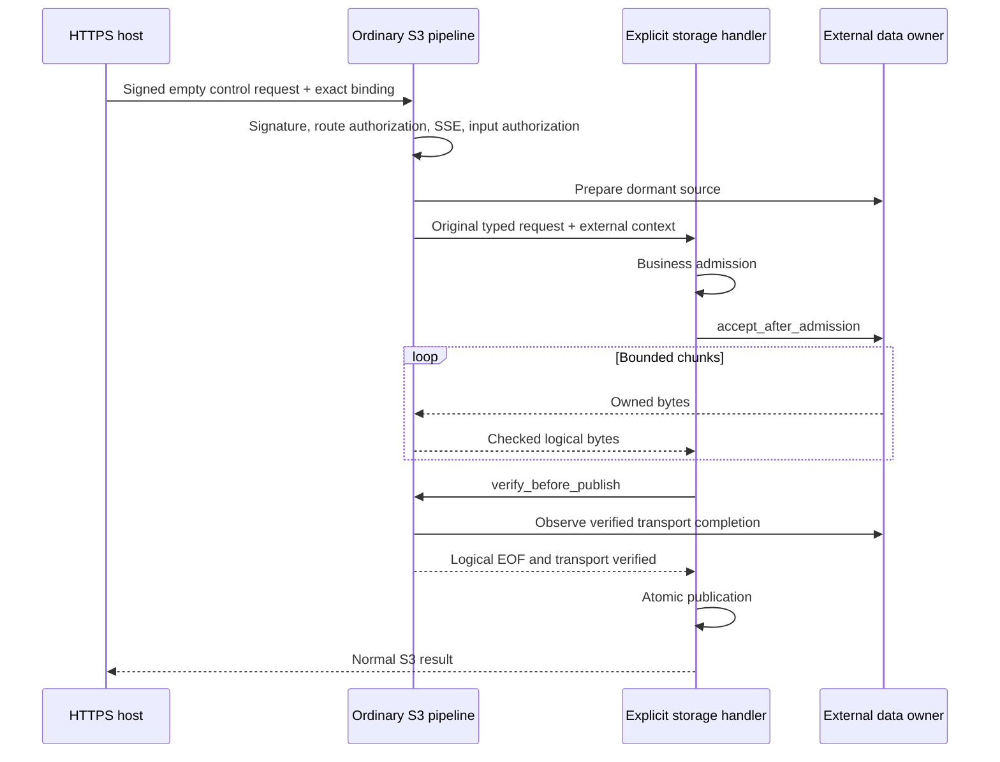

# External object data

The default service keeps its ordinary HTTP body, signature, handler and response behavior.
The `external-payload` feature adds an explicit host entry for object bytes supplied separately.
Device access, peer metadata and control-envelope encoding belong to the selected host package.

## Ownership

| Module | Responsibility |
| --- | --- |
| `rustfs-gateway-core::external_payload` | Pure control, logical completion and explicit storage-handler interfaces |
| `rustfs-gateway::external_payload` | Bound request entry, dormant input, byte accounting and verification |
| `ServiceBuilder::register_external_payload` | Explicitly registers a backend implementing `ExternalPayloadHandler` |
| Storage backend | Business admission, atomic publication and final S3 result |
| Selected host package | HTTPS control codec, data progress, memory ownership and access-end cleanup |

The public workspace has no dependency on a private implementation. Host-selected builds are
composed through the independently selected package described in [RDMA builds](rdma-build.md).

## Upload execution

1. The host requires an exactly empty control body and supplies `ExternalPayloadBinding` with the
   exact extension values, binding digest and logical size.
2. `call_with_external_payload_bound` requires HTTPS and an ordinary S3 SigV4 header signature
   covering every reserved extension field. Uploads use `UNSIGNED-PAYLOAD`; their actual logical
   bytes still pass the normal S3 checksum and MD5 checks.
3. The caller's original headers and physical zero length are used for authentication. The logical
   head supplies the signed logical length to routing, quotas, deadlines and the streaming decoder.
4. Both ordinary authorization stages run before a provider is prepared. A registration without
   explicit external capability is refused before invoking its backend.
5. The capable backend calls `accept_after_admission` after its business admission checks. The body
   remains dormant before acceptance. Each delivered byte passes the existing logical body monitor.
6. The backend calls `verify_before_publish` before its existing atomic publication. This requires
   exact consumption, actual logical EOF and verified data-transport completion.
7. The backend returns its normal S3 result. The selected host encodes its finite control response.

A request filter cannot introduce unsigned extension fields or change a bound field. Signature
verification reads the original caller map; provider preparation validates the accepted context
against the exact bound fields. Customer-key data requires confidential, authenticated protection
from the external transport before any object bytes are supplied.



## Download execution

The ordinary `GetObject` path selects the version, range, conditions and response once. The final
encoded status and duplicate-preserving `HeaderMap` reach `ExternalResponseConsumer::consume`.
The facade adapts file regions through its existing bounded IO driver. The selected body has an
exact size within the request bound; no second object read or handler invocation selects a result.

The consumer binds its transport to that frozen head before polling object bytes. Output uses
bounded backpressure and retains actual EOF trailers. The facade independently observes EOF and
rejects a consumer that reports the expected length without consuming its source.
`ExternalPayloadResponse` carries the logical response and the verified output result. The host
must put the logical head and actual trailers into its finite HTTPS envelope and set the physical
control response length to the envelope size.

## Cancellation and resources

Preparation observes handler cancellation. Output observes explicit request-abort signals; a
closed observer carrying `false` has the same meaning as on the ordinary request path. Dropping
unfinished exchanges requests cancellation. The data owner retains resources until remote access
has ended; neither dropping a future nor returning an S3 refusal proves memory is reusable.

The facade owns no device buffer pool. It forwards bounded owned chunks, preserves existing S3
quota and deadline monitors, and caches one admission and verification result per operation.
Repeated observers share the first terminal cause.

External producers use `ExternalPayloadError::into_stream_error` to retain an explicit
`ProducerFailureClass` and the original error source. Opaque upstream errors keep their existing
transport classification. The execution owner reads the explicit class; it never inspects a
producer's concrete error type at runtime.

## Reference backend

The filesystem reference backend enables this composition with its `external-payload` feature and
`FsBackend::register_with_external_payload`. `PutObject` and `UploadPart` use their existing business
helpers and publication paths. Missing buckets and unknown multipart uploads refuse before data
admission. Logical or transport verification failure leaves no published object or part.
The reference backend collects a complete object or multipart part in memory, as on its ordinary
HTTP path. Its memory consumption therefore grows with object size. Production storage backends
should consume the same streaming interface into their own temporary writers.

## Verification

The facade marker tests check default rejection, signature failure without peer preparation,
explicit registration and logical checksum failure. The filesystem external-data cases exercise
persisted PUT, multipart completion, selected GET bytes, refused publication and claimed EOF.

```sh
cargo test -p rustfs-gateway --features external-payload external_payload
cargo test -p rustfs-gateway-fs --features external-payload external_payload
```
